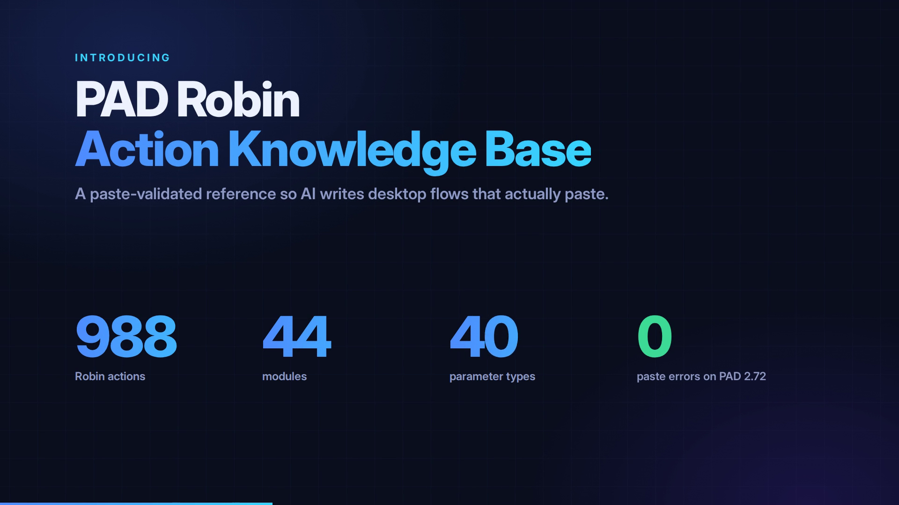

# PAD Robin Action Knowledge Base

A paste-validated reference for the Robin scripting language behind Power Automate Desktop (PAD), built so AI assistants can write desktop flows that actually paste.

There is no official Robin reference. The original language site went offline in 2021, the Designer is the only thing that knows the syntax, and every action has selector variants with different argument sets that the Designer never shows you in text form. Ask a model to write Robin from its training data and you get scripts that PAD silently rejects: paste them, and the canvas stays empty.

This repo is the missing reference.

[](marketing/video/pad-robin-kb-promo.mp4)

## What is in it

| File | Contents |
|---|---|
| `PAD_Robin_ActionKB.json` | 1,086 Robin actions across 46 modules. Every record has a template, a golden example that pasted into PAD Designer with zero errors, typed input and output parameters (enum inputs list their allowed values), the other selector forms of the same action, and whether the action takes an `ON ERROR` handler and under which error names (`error_handling`, new in 3.5.0). |
| `PAD_Robin_TypeReference.json` | 44 parameter types with the exact syntax PAD accepts for each: strings, numbers, file paths, handle variables, lists, UI selectors, and the rule for enums. |
| `PROMPT.md` | A system prompt that turns a model into a template filler over these two files. This is how the data is meant to be used. |
| `PAD_Robin_ActionKB_PowerFx.json` | The **Power Fx edition** (new in 3.4.0): the same 1,086 records with their values written for desktop flows created with Power Fx enabled (`$fx'...'`). Every golden example pasted into a Power Fx-enabled flow with zero errors. See [Power Fx flows](#power-fx-flows). |
| `PAD_Robin_TypeReference_PowerFx.json` | The Type Reference for Power Fx flows. |
| `PROMPT_PowerFx.md` | The system prompt for Power Fx flows. |
| `rules/robin-rules.json` | The syntax rules below, each with the probe pastes that prove it. README, PROMPT.md and other copies are rendered from this file. |
| `rules/probe-corpus.json` | 456 probe pastes (443 into PAD 2.72, 13 into PAD 2.73) with the outcome PAD gave: rejected silently, landed with errors, or clean. Rows include PAD's own description where it was captured. |

**File names stay the same between releases** (since 3.3.1), so a link to the raw file on `main` always gets the latest KB:
`https://raw.githubusercontent.com/JoeG592/pad-robin-action-kb/main/PAD_Robin_ActionKB.json`.
The Power Fx edition works the same way: `.../main/PAD_Robin_ActionKB_PowerFx.json`.
The version is inside each file (`version`, `pad_build`) and in the release tags. To stay on one version, link the file at its tag instead of `main`, for example `.../pad-robin-action-kb/v3.4.0/PAD_Robin_ActionKB.json`.
The old names `PAD_Robin_ActionKB_v3_3.json` and `PAD_Robin_TypeReference_v3_1.json` are still kept but frozen at 3.3.0 (no `error_handling`); use the stable names. They will be removed in a later release.

Validated against PAD 2.73 (build 2.73.00155.26278), October 2026: all 987 golden examples carried over from the 2.72 release were re-pasted exactly as published into the 2.73 Designer, with zero errors, and the two records that are new or changed in 2.73 (`ComputerUse.InvokeComputerUse`, `LLM.InvokeLLM`) were paste-validated on the same build. 3.3 adds 97 records that act on a recorded UI element (50 desktop, 47 web), paste-validated on 2.73 against placeholder elements; see `needs_ui_selector` below. The syntax rules below were probed on PAD 2.72 in October 2026 with 563 test pastes, including 19 complex flows of up to 97 rows, and all 443 published probes were re-pasted on 2.73 with the same outcomes.

## The two-table idea

Do not ask the model to write Robin. Ask it to pick an action from the KB, copy the golden example, and change the values, using the Type Reference to format each value. The model does lookup and substitution, not code generation. In practice this took a pipeline from roughly one working script in five to scripts that paste clean on the first try, including 30-action compositions with loops and conditions.

## Fields

```json
{
  "actionId": "Text.JoinText.JoinWithDelimiter",
  "module": "Text",
  "kind": "Action",
  "selector": "JoinWithDelimiter",
  "template": "Text.JoinText.JoinWithDelimiter List: `` StandardDelimiter: Text.StandardDelimiter.Space DelimiterTimes: 1 Result=> JoinedText",
  "golden_example": "Text.JoinText.JoinWithDelimiter List: List StandardDelimiter: Text.StandardDelimiter.Space DelimiterTimes: 1 Result=> JoinedText",
  "input_params": [ { "name": "List", "type": "List`1<String>", "required": true }, ... ],
  "output_params": [ { "name": "Result", "type": "String", "defaultVariable": "JoinedText" } ],
  "constraints": { "DelimiterType": "Standard" },
  "sibling_selectors": [ "Text.JoinText.Join", "Text.JoinText.JoinWithCustomDelimiter" ],
  "needs_ui_selector": false,
  "error_handling": { "on_error": false, "errors": [] },
  "validation": "paste-validated 2026-09 (PAD 2.72) ..."
}
```

- **actionId** is the Robin id: `Module.Action` or `Module.Action.Selector`.
- **kind** tells you the wrapper. `Condition` records are written `IF (...) THEN` and need an `END`; `Wait` records are `WAIT (...)`; `While` records are `LOOP WHILE (...)` with an `END`.
- **template** has empty backticks where you must supply a value. **golden_example** is the same line with placeholder values, and it pasted into the Designer without a single error.
- **input_params** names are the Robin argument names. Some differ from PAD's internal property names, for example `Element` rather than `Control`, so always use these.
- **sibling_selectors** is the field that matters most for non-trivial scripts. `Text.JoinText.Join` takes only a list. If you need a delimiter, the argument does not exist on that form; it lives on `JoinWithDelimiter`. Adding an argument from one form to another gives "Unknown argument". Inventing a selector name gives an empty canvas.
- **constraints** are the properties a selector fixes, which is why they are absent from its arguments.
- **needs_ui_selector** marks 114 records whose input is a recorded UI element, web element, or image. Their examples will not run as written; the shape is still correct.
  - 97 refer to placeholder elements: `appmask['Window \'KB Test Window\'']['Button \'OK\'']`, `appmask['Web Page \'KB Test Page\'']['Button \'Submit\'']`. Record your own element in the Designer (UI elements pane) and put its names in the same `appmask['<screen>']['<element>']` form; the apostrophes inside the names are escaped as `\'`. These were validated by pasting into a flow whose UI element repository held the placeholders. The paste checks the reference: an element the flow doesn't have gives "UI element '...' wasn't found".
  - 17 were validated before 3.3: 14 use the text placeholder `Control: $'''body'''` (replace it the same way) and 3 are Windows OCR actions whose screen region is a placeholder.
- **error_handling** (new in 3.5.0) says whether an action can take an `ON ERROR` handler, and under which error names. 1,016 records have `on_error: true` and list the errors the action declares, for example `File.ReadTextFromFile.ReadText` declares `FileNotFoundError` among others. 70 have `on_error: false`: `Text.JoinText`, `Text.ChangeCase`, `Variables.CreateNewList`, `DateTime.Add`, `File.IfFile` and the other actions that never raise an error. Use a handler only where `on_error` is true:

  ```
  File.ReadTextFromFile.ReadText File: $'''C:\Reports\in.txt''' Encoding: File.TextFileEncoding.UTF8 Content=> Content
  ON ERROR FileNotFoundError
      SET Content TO $'''missing'''
  ON ERROR
      SET Failed TO True
  END
  ```

  Named cases come first and the plain `ON ERROR` (any other error) last; one `END` closes them all. A condition or wait takes its handler on the line after `IF (...) THEN` or `WAIT (...)`; a `WAIT` takes one even when its action declares no errors, because the wait itself can time out. Why it matters: an `ON ERROR` on an action with `on_error: false` lands in the Designer with "Exception handling isn't supported for this statement", and a name the action doesn't declare gives "Unknown exception". A flow that has either anyway, because it was written outside the Designer, still runs from the Console, but a **cloud-triggered run rejects the whole flow when it loads**. To guard actions that can't raise errors, put them in `BLOCK ... ON BLOCK ERROR`. Every record was load-tested through cloud-triggered runs on PAD 2.73, in both editions; see [How it was validated](#how-it-was-validated).

## Syntax rules PAD enforces

<!-- robin-rules:begin -->
Every rule below was confirmed by pasting into PAD 2.72 (2.72.00183.26250): 443 probe pastes in October 2026, and 13 on PAD 2.73 for the error-handler forms, kept with their outcomes in `rules/probe-corpus.json`. Most failures are silent. PAD drops the whole paste, the canvas stays empty and no error is shown, so one bad line costs the whole script.

**Values**

1. Strings are `$'''value'''`. Booleans are bare `True` / `False`. Numbers are bare. An empty string is `$''''''`. The backticks in templates mean "fill this in"; pasted as-is they give "Can't be empty".
2. A variable from an earlier action is referenced by its bare name (`Instance: ExcelInstance`). Expressions are bare too: `SET Total TO Price * Qty`, `IF Files.Count = 0 THEN`, `WAIT Attempt * 10`, `Items[Items.Count - 1]`, `Items[-1]`, `Row['Amount']`, `Obj.a.b`.
3. **`%...%` belongs only inside strings**: `$'''Saved %Count% files'''`, `$'''Total %Price * Qty%'''`. Anywhere else it rejects the whole paste, for example `SET X TO %N + 1%`, `IF %N% = 5`, `Text: %Msg%` or `WAIT %N%`.
4. Enums are fully qualified, `Module.EnumType.Value`, using the module that owns the type (`Text.StandardDelimiter.NewLine`). The value must be one the KB lists in the input's `enumValues`: `File.IfExists`, for example, has only `DoNothing` and `Overwrite`. An enum without its module is an error.
5. Outputs are `Name=> Variable`.

**Inside strings**

6. The backslash is an escape character inside strings: `\'` is an apostrophe and `\\` is one backslash. **Escape every apostrophe**: `$'''Joe\'s report'''`, `$'''WHERE Name = \'Joe\''''`. A bare `'` rejects the whole paste, so watch SQL, XPath and JavaScript. Apostrophes inside a `%...%` expression are fine (`$'''%Row['Name']%'''`).
7. **Double a backslash that comes right before a variable or before the closing quotes**: `$'''C:\Reports\\%Month%'''`, `$'''%Root%\\%Name%'''`, `$'''C:\Temp\\'''`. A single backslash there rejects the whole paste. Before an ordinary letter one backslash is kept as is (`$'''%Folder%\Report.xlsx'''`). Don't write `\%`: PAD drops the percent sign.
8. **A UNC path needs four backslashes**, `$'''\\\\server\share'''`. With two it pastes, but PAD reads `\server\share`.
9. **A literal percent sign is `%%`**: `$'''100%% done'''`. A single `%` rejects the whole paste.
10. Strings may span several lines, including blank lines and lines that start with `END`, `#` or `IF`.

**Names**

11. **PAD keywords can't be variable or property names**: `From`, `To`, `Step`, `End`, `In`, `Then`, `If`, `Else`, `Loop`, `Foreach`, `While`, `Set`, `Wait`, `Next`, `Exit`, `Label`, `Goto`, `Call`, `Case`, `Default`, `Switch`, `Block`, `Error`, `On`, `Not`, `And`, `Or`, `Mod`, `True`, `False`, `Global`, `Disable`, `Function`, `Throw`. Mail properties are the usual trap: write `Mail['From']` and `Mail['To']`, not `Mail.From`. `Subject`, `Count`, `Name`, `Text`, `Value` and `Body` are fine.
12. Variable names start with a letter: `SET 1abc TO 1` rejects the whole paste. Unicode letters are fine (`SET Café TO 1`).
13. A variable must be set somewhere in the flow, by `SET`, an action output, a loop, or an in-place list action such as `Variables.AddItemToList List:`. Otherwise the line shows "Variable 'X' doesn't exist".
14. Variable names, keywords, action ids, enum values and argument names are all case-insensitive on paste.

**Statements**

15. One statement per line; two on one line rejects the whole paste. Indentation is cosmetic, and a trailing `# note` becomes its own comment row.
16. Built-in statements:
    - `SET x TO value`
    - `IF condition THEN` / `ELSE IF condition THEN` / `ELSE` / `END`
    - `SWITCH x` / `CASE = 1` / `CASE > 5` / `DEFAULT` / `END`
    - `LOOP FOREACH item IN list` / `END`
    - `LOOP i FROM 0 TO n - 1 STEP 1` / `END`
    - `LOOP WHILE (A) < (B)` / `END`
    - `EXIT LOOP`, `NEXT LOOP`, `LABEL Name` / `GOTO Name`, `WAIT 5`, `EXIT Code: 0`
17. Conditions use `=`, `<>`, `>`, `<`, `>=`, `<=`, `AND`, `OR` and `NOT(...)`, plus `IsEmpty(x)`, `IsNotEmpty(x)`, `Contains(x, $'''y''', False)`, `NotContains`, `StartsWith` and `EndsWith`.
18. `CASE` takes a comparison only (`CASE = 1`, `CASE <> 3`, `CASE > 5`). `CASE Contains ...` rejects the whole paste.
19. A condition action (kind `Condition`) is written `IF (Action ...) THEN`. `ELSE IF (Action ...) THEN` rejects the whole paste, so use `ELSE` with a nested `IF (Action ...) THEN ... END`.
20. Error handling for a group of actions, and for a single action:

    ```
    BLOCK ReadFiles
    ON BLOCK ERROR
        SET Failed TO True
    END
        ...actions...
    END

    Text.ToNumber Text: Raw Number=> Amount
    ON ERROR REPEAT 2 TIMES WAIT 5
    ON ERROR TextNotValidNumberError
        SET Amount TO 0
    ON ERROR
        SET Failed TO True
    END
    ```

    An action's handler goes on the lines right after it (for a condition or a wait, right after `IF (...) THEN` or `WAIT (...)`). The optional `ON ERROR REPEAT n TIMES WAIT n` comes first (it also takes `RetryType: RetryType.Exponential MinInterval: 1 MaxInterval: 10`), then any `ON ERROR <Name>` cases, then the plain `ON ERROR`; one `END` closes them all. A named case after the plain `ON ERROR`, or a second `ON ERROR ... END` after the first, drops the whole paste.

    A handler may contain only `SET`, `CALL`, `GOTO` and `THROW ERROR`. Any other statement, `NEXT ACTION` included, gives "The statement isn't allowed inside exception handling", and an `IF` inside a handler rejects the whole paste. Set a flag in the handler and act on it after the block. `REPEAT` works only on an action's `ON ERROR`. A named `ON BLOCK ERROR` case is for custom error codes: `ON BLOCK ERROR MyErr IsUserDefinedErrorCode: True` catches `FlowControl.ThrowCustomError CustomErrorCode: $'''MyErr'''`. `ERROR => LastError` reads the last error.
21. `ON ERROR` only on an action that can raise errors: its KB record has `error_handling.on_error: true`, and a named case uses a name from its `error_handling.errors`. On any other action the row lands with "Exception handling isn't supported for this statement", and a name the action doesn't declare gives "Unknown exception 'X'". A flow that has either anyway (written outside the Designer) runs from the Console, but a cloud-triggered run rejects the whole flow when it loads. Put actions that can't raise errors in `BLOCK ... ON BLOCK ERROR` instead. A `WAIT (...)` takes `ON ERROR` even when its action declares no errors, because the wait itself can time out.
22. Comments are `# text` or `/# ... #/`. Regions are `**REGION Name` / `**ENDREGION`; `REGION` / `END REGION` rejects the whole paste. A `DISABLE ` prefix disables a line.
23. Don't paste the file header lines (`@@ConnectionString`, `IMPORT`, `@SENSITIVE`) or subflow definitions (`FUNCTION ... END FUNCTION`): both reject the whole paste. Create subflows in the Designer and paste each body into its own subflow. `@@copilotGeneratedAction: 'False'` works only directly before an action; other `@@` lines reject the paste.
24. Ids removed in PAD 2.72 are rejected as "Unknown action": the bare `Database.Connect` (use `Database.Connect.Connect` or `.ConnectOracle`) and the bare `Scripting.RunPythonScript` (use `.RunPythonScript`, `.RunPythonScript34` or `.RunPythonScriptCPython`).

The 3.1.3 documentation said property access in an `IF` condition rejects the paste. That was wrong: it does not reproduce, and the form that fails is `%...%` outside a string.

`marketing/video/tools/check-flows.js` checks a script against these rules and the KB before you paste it:

```
node marketing/video/tools/check-flows.js PAD_Robin_ActionKB.json flow.robin
```

On the probe corpus it flags 107 of 107 silent rejects and 22 of 27 pastes that landed with errors, and passes 320 of 322 clean pastes. The 2 it flags use `\%`, which PAD accepts while silently dropping the percent sign.
<!-- robin-rules:end -->

## Troubleshooting

- **"Can't edit flow: Failed to deserialize Flow."** when opening a flow in the Designer means the flow's saved Robin doesn't parse. It's the same syntax a paste silently drops, so the silent-reject rules above are the usual cause (for example `%...%` outside a string, or an unescaped apostrophe). A flow in this state also fails to run ("Load failed."). The Designer can't open it to fix it, so check the script where it came from with `check-flows.js`, fix it, and paste it into a new flow (or restore an earlier version of the flow, if your environment keeps version history). The dialog's error details only give a correlation id; PAD's local Designer log records the parser error under that id (`RobinScriptParsingError`), with the grammar rule but no line number.

## How it was validated

Every golden example was pasted into PAD Designer through UI automation and accepted with zero errors in the error pane. The March 2026 set (369 records) was additionally run through producer-to-consumer chains, so that, for example, an Excel action was validated with a real `ExcelInstance` from a launch action before it. The September 2026 sets were validated the same way in batches, with each action's error flag read back from the canvas individually: 578 records on PAD 2.67, and 46 records on PAD 2.72 (the new PowerPoint, PGP, LLM, Triggers and environment actions, plus records whose arguments changed in 2.72).

After each PAD update, the action ids and argument lists of every record are re-extracted from the module DLLs and compared. Records whose arguments changed are re-pasted on the new build, and records that no longer exist are removed (see CHANGELOG). Then every golden example in the release is re-pasted exactly as published on the new build. Each example gets the variables it references, such as an `ExcelInstance` or a `FileList`, from a validated producer action placed before it in the same paste. For PAD 2.72 that full re-paste was 988 examples in 83 batches with zero errors; each record's `validation` field records it.

`error_handling` (3.5.0) was tested on the path that is strictest about it: a cloud-triggered run ("Run a flow built with Power Automate for desktop"), whose agent checks every line of the flow before it starts and rejects the whole flow on any error. The Designer flags the same handlers when you paste them, but a flow written outside the Designer (through the API, or generated and never pasted) still runs from the Console, so this is where they surface. Every published golden example was written into a test flow, behind an `IF` that is never true so nothing actually ran, and the flow was started from the cloud: records with `on_error: true` in batches with `ON ERROR <Name>` for each listed error plus a default `ON ERROR`, which loaded; records with `on_error: false` one at a time with a plain `ON ERROR`, each of which was rejected. Both editions, PAD 2.73, 334 runs. Controls showed the test can tell the two apart: a made-up error name was rejected, the same action with its real name loaded. Real runs confirmed the routing: a named case caught its error ahead of the default, a custom error code reached its `ON BLOCK ERROR MyErr IsUserDefinedErrorCode: True` case, and a `WAIT ... FOR 2` timeout reached `ON ERROR`. 13 paste probes on PAD 2.73 back the syntax rules for these forms. The error names come from the error declarations in PAD's module DLLs; where the loader disagreed with the DLLs (a `WAIT` takes `ON ERROR` even when its action declares no errors, because the wait itself can time out), `on_error` follows the loader.

Pasting proves the golden example, not the metadata around it. So before each release, every record is also checked against the PAD module DLLs: its argument and output names and types, the arguments its template and example use, and its selector, constraints and sibling forms. The Type Reference's producer actions get the same check. A release is not published unless that check has zero errors.

Validation means the Designer accepts the line. It does not mean the placeholder values make sense for your task; that is the model's job.

## What is not in this release

PAD 2.73 exposes 139 further selector variants that are not included here: 103 need a recorded image or UI element that the placeholder elements don't cover (mostly image-based mouse and OCR actions), 25 need a live mail or work-queue connection to validate, and 11 are deprecated, removed, or unknown to the Designer. They may follow in a later release.

## Using it with an AI assistant

1. Give the model `PROMPT.md` as the system prompt.
2. Include the Type Reference, and the KB records for the modules your task needs (the full KB is about 3 MB; filter by `module`).
3. Ask for the flow. Run it through `marketing/video/tools/check-flows.js`, then paste the result into an empty flow in PAD Designer.
4. If the error pane lists anything, feed the messages back to the model with the same context.

For a flow created with Power Fx enabled, use the Power Fx files and `PROMPT_PowerFx.md` instead (next section).

## Power Fx flows

A desktop flow can be created with Power Fx enabled. Its Robin is the same (same action ids, argument names, enums, outputs and statements), but its values are written differently: text is `$fx'...'`, expressions start with `=`, and interpolation is `${...}`. The Power Fx edition has every record of the classic KB with its template and golden example converted to that form, and every golden example was pasted into a Power Fx-enabled flow on PAD 2.73 with zero errors (1,086 records, 90 batches).

**Which edition do I need?** Look at a text value in the flow: `$fx'...'` is a Power Fx flow, `$'''...'''` is classic. (In the flow's stored definition, a Power Fx flow has `PowerFxEnabled: true`.)

| | Classic | Power Fx |
|---|---|---|
| Text | `$'''Hello'''` | `$fx'Hello'` |
| Expression | `SET Total TO Price * Qty` | `SET Total TO $fx'=Price * Qty'` |
| Variable in text | `$'''Total %Total%'''` | `$fx'Total ${Total}'` |
| Literal percent sign | `$'''100%% done'''` | `$fx'100% done'` |
| Apostrophe | `$'''Joe\'s'''` | `$fx'Joe\'s'` |
| List item / count | `L[0]`, `L.Count` | `Index(L, 1).Value`, `CountRows(L)` |
| Index arguments (`RowIndex`, `ItemIndex`, ...) | 0-based | 1-based |
| A file in text | `%File%` | `${File.FullName}` |

**A clean paste is not the whole check.** In a classic flow, a script that pastes with zero errors runs. In a Power Fx flow some expressions paste clean and fail only when the flow runs: classic list access (`L.Count`, `L[0]`) is the main case, and `ON ERROR` / `ON BLOCK ERROR` do not catch it. The KB's `power_fx` block lists the value rules and these run-time traps. Run a new Power Fx flow once with real values in a test flow before you rely on it.

Power Fx flows run from the cloud ("Run a flow built with Power Automate for desktop") as well as from the PAD Console. Two things to know about cloud-triggered runs on PAD 2.73:

- `ON ERROR` on an action that can't raise an error makes a cloud-triggered run reject the flow when it loads, in either edition. The same flow runs from the Console. Each record's `error_handling.on_error` says which actions take a handler (see [Fields](#fields)).
- In a Power Fx flow, PAD reports *any* error it finds while loading the flow as "This flow contains an incompatible PowerFx version", even when the versions match. It is not a version problem: the real error is in PAD's logs (`C:\ProgramData\Microsoft\Power Automate\Logs`, the RobinEngine log, event `robin.project.validate.flowcontainserror`), for example a record such as a file or an error placed inside text. 3.4.0 said Power Fx flows don't run from the cloud; that was this message, not a real limit.

The checker, `check-flows.js`, is for classic Robin only. It doesn't understand `$fx'...'` values yet and reports false errors on Power Fx scripts.

Two data table literals (`Variables.CreateNewDatatable`, `Excel.SortCellsFromExcel.SortWorksheet`) keep the classic `{ ... }` form, which pasted clean in the Power Fx flow.

## Maintenance

PAD updates add and change actions. The KB carries the PAD build it was validated against, and the intent is to re-validate after each Designer release. Issues and pull requests are welcome; a report of a record that fails to paste on a newer build is the most useful kind.

The syntax rules live in `rules/robin-rules.json`. To change one, edit that file and run `node rules/render-rules.js`, which updates this README and PROMPT.md. It refuses to render if a rule cites a probe that doesn't show what the rule claims. `node --test rules/*.test.js marketing/video/tools/*.test.js` checks the evidence, checks the checker against every rule's examples, and checks that the rendered copies are current.

## License

The data files are released under Creative Commons Attribution 4.0 (CC BY 4.0). Use them for anything, including commercially, with attribution.

Built by Joe Green while automating Power Automate Desktop for real-world use.
